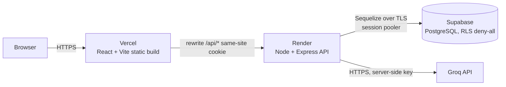

# fullstack-expense-tracker

> Working name. Final name pending (see `planning/PROPOSAL.md`).

A personal expense tracker: sign up, log expenses by category, set a monthly budget, see where the money goes, check whether a planned purchase fits, and ask a small AI helper for spending tips. Built as the Full Stack Development mini project for TE AI&DS at VESIT, porting FinSight to the syllabus stack.


## Architecture



The browser only ever talks to the Vercel domain. Vercel rewrites `/api/*` to Render, so the auth cookie is first-party and `SameSite=Lax` works. Only the Express server holds DB credentials and the Groq key.

## Local setup

Prerequisites: Node.js 20 LTS, npm, Git, a Supabase project (or local Postgres), a Groq API key.

```bash
git clone <repo-url>
cd fullstack-expense-tracker

cp .env.example server/.env        # fill in the values
cd server && npm ci && npx sequelize-cli db:migrate && npx sequelize-cli db:seed:all && npm run dev
cd ../client && npm ci && npm run dev   # http://localhost:5173, proxies /api to :4000
```

> Commands become real as each phase lands; see `CLAUDE.md`.

## Environment variables

All live in `server/.env`. The client has none.

| Variable | Required | Description | Example |
|---|---|---|---|
| `NODE_ENV` | yes | `development` / `production` / `test` | `development` |
| `PORT` | yes | API port (Render sets this) | `4000` |
| `LOG_LEVEL` | no | pino level | `info` |
| `DATABASE_URL` | yes | Supabase **session pooler** URI (IPv4) | `postgresql://postgres.ref:pw@aws-0-ap-south-1.pooler.supabase.com:5432/postgres` |
| `DATABASE_CA_CERT` | prod | Supabase CA certificate (PEM) for verified TLS | `-----BEGIN CERTIFICATE-----...` |
| `JWT_SECRET` | yes | 64+ random bytes, hex | `9f2c...` |
| `JWT_EXPIRES_IN` | yes | Token lifetime | `30m` |
| `CORS_ORIGINS` | yes | Comma-separated exact origins | `http://localhost:5173` |
| `GROQ_API_KEY` | yes | Groq key, server only | `gsk_...` |
| `GROQ_MODEL` | no | Small fast model | `llama-3.1-8b-instant` |
| `MONGODB_URI` | optional | Only if the MongoDB option is chosen | `mongodb+srv://...` |

## Deployment

**Supabase (database)**
1. Create a free project (region: Mumbai `ap-south-1`).
2. Copy the *Session pooler* connection string (Render has no IPv6, so not the direct one) and download the SSL certificate.
3. Run migrations from your machine: `DATABASE_URL=... npx sequelize-cli db:migrate`. Migrations enable RLS on every table and revoke `anon`/`authenticated` access.
4. In API settings, disable the Data API or remove the app schema from exposed schemas.

**Render (API)**
1. New → Blueprint, point at the repo; `render.yaml` defines the web service (root `server/`, `npm ci`, `npm start`, health check `/healthz`).
2. Set env vars from the table above. `CORS_ORIGINS` = your Vercel URL.

**Vercel (client)**
1. Import the repo, root directory `client/`, framework Vite.
2. `client/vercel.json` rewrites `/api/(.*)` to `https://<render-service>.onrender.com/api/$1` and everything else to `/index.html` for React Router.

Free-tier caveats (Render cold starts, Supabase pausing, Groq rate limits) are in `planning/PROPOSAL.md`.

## Syllabus coverage

Every syllabus topic is mapped to a file or feature and a viva demo in [`planning/SYLLABUS_MAPPING.md`](planning/SYLLABUS_MAPPING.md). Content beyond syllabus is in [`planning/BEYOND_SYLLABUS.md`](planning/BEYOND_SYLLABUS.md).

## Contributing

- Never push to `main`. Branch as `name/topic`.
- Conventional Commits (`feat: add expense update route`).
- Open a PR using the template; one reviewer must approve and CI must pass before merge.

## Team

| Name | Roll no. | Role |
|---|---|---|
| _TBD_ | _TBD_ | _TBD_ |
| _TBD_ | _TBD_ | _TBD_ |
| _TBD_ | _TBD_ | _TBD_ |
| _TBD_ | _TBD_ | _TBD_ |

**Guide:** _TBD_ · Department of Artificial Intelligence & Data Science, VESIT · A.Y. 2026-27

## Credits

Based on [FinSight](https://github.com/aneeshpardikar/FinSight) by [@aneeshpardikar](https://github.com/aneeshpardikar): UI design, layout and feature set. This repo rewrites the frontend in React + Vite and the backend in Node/Express/Postgres.
