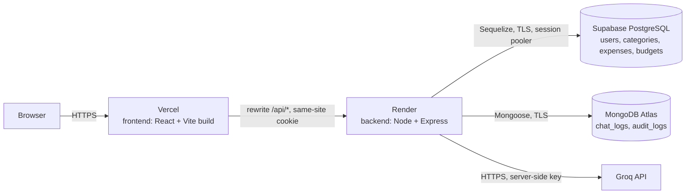

# finsight-fullstack

A personal expense tracker: sign up, log expenses by category, set a monthly budget, see where the money goes, check whether a planned purchase fits, and ask a small AI helper for spending tips. Built as the Full Stack Development mini project for TE AI&DS at VESIT, porting FinSight to the syllabus stack.


## Architecture



The browser only ever talks to the Vercel domain. Vercel rewrites `/api/*` to Render, so the auth cookie is first-party and `SameSite=Lax` works. Only the backend holds database credentials and the Groq key.

## Repository layout

```
finsight-fullstack/
├── frontend/        React 18 + Vite + React Router (Vercel)
├── backend/         Express 5 API (Render)
│   └── node-core/   standalone Node.js core demos for the viva
├── database/        Sequelize (Postgres) + Mongoose (MongoDB): models, migrations, seeders
├── docs/
│   ├── planning/    proposal, plan, tech stack, syllabus mapping, security, beyond-syllabus
│   └── report/      project report sections (on hold) and Mermaid diagrams
└── .github/         PR template; CI added in Phase 9
```

The three code folders are npm workspaces sharing one lockfile. Details: [`docs/planning/TECH_STACK.md`](docs/planning/TECH_STACK.md).

## Local setup

Prerequisites: Node.js 22 LTS or newer, npm, Git, a Supabase project, a MongoDB Atlas M0 cluster and a Groq API key.

```bash
git clone <repo-url>
cd finsight-fullstack
cp .env.example .env          # fill in the values
npm ci                        # installs all workspaces
npm run db:migrate            # Postgres schema (database workspace)
npm run db:seed               # categories + demo user
npm run dev                   # backend on :4000 and frontend on :5173 (Vite proxies /api)
```

> These scripts arrive with Phases 1 to 3; see `CLAUDE.md` for what exists today.

## Environment variables

One `.env` at the repo root, used by `backend` and `database`. The frontend has none.

| Variable | Required | Description | Example |
|---|---|---|---|
| `NODE_ENV` | yes | `development` / `production` / `test` | `development` |
| `PORT` | yes | API port (Render sets this) | `4000` |
| `LOG_LEVEL` | no | pino level | `info` |
| `DATABASE_URL` | yes | Supabase **session pooler** URI (IPv4) | `postgresql://postgres.ref:pw@aws-0-ap-south-1.pooler.supabase.com:5432/postgres` |
| `DATABASE_CA_CERT` | prod | Supabase CA certificate (PEM) for verified TLS | `-----BEGIN CERTIFICATE-----...` |
| `MONGODB_URI` | yes | Atlas connection string for the least-privilege app user | `mongodb+srv://finsight_app:pw@cluster0.xxxx.mongodb.net/finsight` |
| `JWT_SECRET` | yes | 64+ random bytes, hex | `9f2c...` |
| `JWT_EXPIRES_IN` | yes | Token lifetime | `30m` |
| `CORS_ORIGINS` | yes | Comma-separated exact origins | `http://localhost:5173` |
| `GROQ_API_KEY` | yes | Groq key, backend only | `gsk_...` |
| `GROQ_MODEL` | no | Small fast model | `llama-3.1-8b-instant` |

## Deployment

**Supabase (Postgres)**
1. Create a free project in the Mumbai region (`ap-south-1`).
2. Copy the *Session pooler* connection string. Render has no IPv6, so don't use the direct connection string. Also download the SSL certificate.
3. Run migrations from a laptop: `npm run db:migrate` with the production `DATABASE_URL`. The migrations enable RLS on every table and revoke `anon`/`authenticated` access.
4. In the API settings, disable the Data API.

**MongoDB Atlas**
1. Create an M0 cluster near Mumbai.
2. Add a database user `finsight_app` with `readWrite` on the `finsight` database only. Generate a strong password for it.
3. Network access: `0.0.0.0/0` (Render free tier has no static IPs). This is covered by the password, TLS and the least-privilege user.

**Render (backend)**
1. New → Blueprint, using `render.yaml` at the repo root. The build runs `npm ci -w backend -w database`, the start command is `npm start -w backend`, and the health check is `/healthz`.
2. Set the env vars from the table. `CORS_ORIGINS` is the Vercel URL.

**Vercel (frontend)**
1. Import the repo with root directory `frontend/` and framework preset Vite.
2. `frontend/vercel.json` rewrites `/api/(.*)` to `https://<service>.onrender.com/api/$1`, sends every other path to `/index.html`, and sets the security headers.

Free-tier caveats (Render cold starts, Supabase and Atlas pausing, Groq rate limits) are listed in [`docs/planning/PROPOSAL.md`](docs/planning/PROPOSAL.md).

## Syllabus coverage

Every syllabus topic (84 of 84) is mapped to a file or feature and a viva demo in [`docs/planning/SYLLABUS_MAPPING.md`](docs/planning/SYLLABUS_MAPPING.md). Content beyond the syllabus is in [`docs/planning/BEYOND_SYLLABUS.md`](docs/planning/BEYOND_SYLLABUS.md).

## Contributing

- Never push to `main`. Branch as `name/topic` (e.g. `om/node-core`).
- Use Conventional Commits (`feat: add expense update route`).
- Open a PR using the template. One reviewer must approve and CI must pass before merging.

## Team

| Name | Roll no. |
|---|---|
| Athang Malgundkar | 27 |
| Om Mane | 28 |
| Aneesh Pardikar | 38 |
| Aryan Shetty | 46 |

**Guide:** _TBD_ · Department of Artificial Intelligence & Data Science, VESIT · TE, A.Y. 2026-27

## Credits

Built on [FinSight](https://github.com/aneeshpardikar/FinSight), originally created by team member Aneesh Pardikar ([@aneeshpardikar](https://github.com/aneeshpardikar)). FinSight provides the UI design, layout and feature set. This repo rewrites the frontend in React + Vite and the backend in Node, Express, PostgreSQL and MongoDB.
