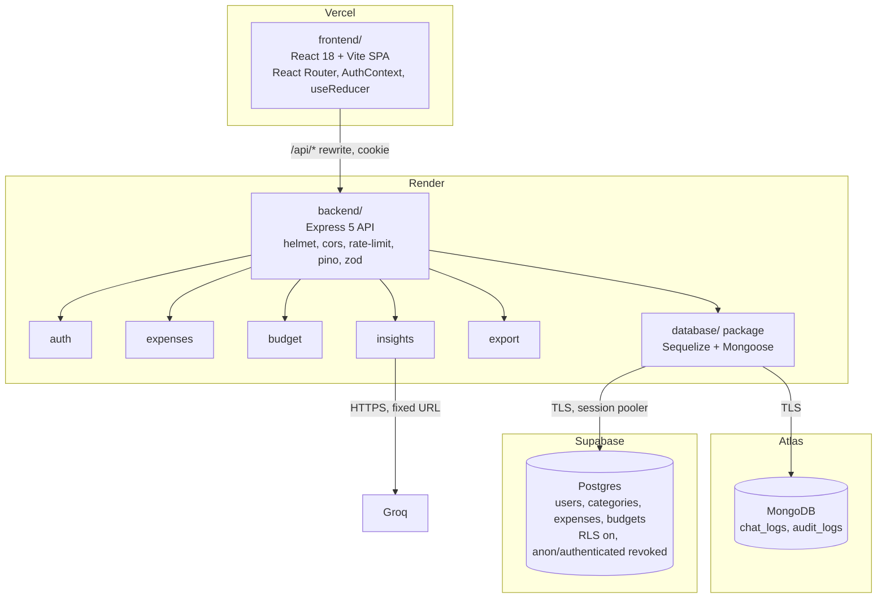

# Proposal

**Project:** finsight-fullstack · **Team:** Athang Malgundkar (27), Om Mane (28), Aneesh Pardikar (38), Aryan Shetty (46) · **Guide:** _TBD_ · **Deadline:** _TBD_

## 1. Problem

Students and young earners track spending loosely, if at all: a notes app, a bank SMS, or a spreadsheet they abandon in week two. They don't know how much of the month's budget is left, which category is leaking money, or whether a purchase they're about to make fits. Existing apps have drawbacks: Walnut/axio scrapes SMS and is privacy-heavy, Money Manager is ad-supported, and Splitwise is built for splitting bills rather than personal budgeting.

## 2. Objectives

1. A private, account-based expense tracker where users can add, edit, delete, filter, paginate and export expenses.
2. A monthly budget with progress, a category breakdown and an "afford this?" check.
3. A short AI tip based on the user's totals, never their raw data.
4. Built on exactly the syllabus stack (React + React Router, Node + Express, PostgreSQL + Sequelize, MongoDB + Mongoose, JWT + bcrypt, Vercel + Render), with every syllabus topic demonstrable in a viva.
5. Secure by design, mapped to the OWASP Top 10:2025.
6. Visually identical to FinSight.

## 3. Scope

**In scope:**
- Accounts: register, login, logout.
- Expenses: CRUD with categories and dates, server-side pagination and filtering.
- Budget and analysis: monthly budget, dashboard and analytics computed from real data, "Can I Afford This?".
- AI insights.
- Export: CSV and XML.
- Logs: AI usage and auth audit logs in MongoDB.
- Supporting work: Node core demos, tests, CI, deployment.

**Out of scope:**
- Bank or SMS import.
- Multi-currency (₹ only).
- Shared expenses.
- A mobile app.
- Email verification and password reset by email (no free mail provider is in the stack; future scope).
- Refresh-token rotation.

## 4. What we keep from FinSight

- **The UI:**
  - `app/globals.css` verbatim, with its class names.
  - Sidebar (5 nav items, profile, logout) and header (search box and "Add expense").
  - Cards, budget ring, category bars, recent rows, transaction table, analytics bento and donut.
  - AI panel, Afford page, auth screen, and all copy.
- **The fonts:** DM Sans and Manrope, now self-hosted through `@fontsource` instead of Google Fonts. They look the same.
- **The features:** auth, expenses, budget, analytics, AI insights, Can I Afford This?
- **The categories:** Food & Dining, Shopping, Transport, Entertainment, Bills, Health, Other. Currency is ₹ with `en-IN` formatting.
- **Ideas worth porting:**
  - The httpOnly cookie for the JWT.
  - User-scoped queries.
  - The `money()` and `groupExpenses()` helpers.

## 5. What we drop

| Item | Why |
|---|---|
| Next.js (`app/`, `layout.js`, API proxy routes) | The syllabus asks for React Router; Vite + a Vercel rewrite replaces the proxy |
| FastAPI, SQLAlchemy, SQLite, Pydantic | Replaced by Express, Sequelize, Postgres and zod |
| `app.py` (Streamlit), `test_stock.py`, `/stock/:symbol` (yfinance), Portfolio model and routes | Leftovers from the "Stockflow/stockbot" investment app, unrelated to expenses |
| `auth.py` | Dead code with a hard-coded `SECRET_KEY` |
| Plain-text legacy password login and duplicate-username handling in `/login` | Insecure migration path; we start with a fresh DB and unique usernames |
| Generic `/chat` with a "stock market analyst" prompt, full-text `messages` table and `/history` | Replaced by a narrow `POST /api/insights`; only metadata is logged, to MongoDB |
| "Stockflow"/"stockbot" names (page title, package name, cookie name, DB file) | Renamed to FinSight |

## 6. What FinSight only fakes, and we make real (with the look unchanged)

- Pagination buttons always show page 1 → server-side pagination.
- The date button does nothing → a date-range filter.
- The header search box does nothing → debounced search over descriptions.
- Monthly Spending Trend bars use hard-coded heights for Jan to Jun → the last 6 months from real data, using a month generator.
- The donut uses hard-coded conic-gradient stops → percentages from category totals.
- The budget ring has static borders → it reflects the percentage used.
- All totals are all-time → scoped to the current month.
- **Stays visual only (team decision):** the two view toggles in the transaction toolbar, the "6M / 1Y" chart tabs and the "•••" button.

## 7. Target architecture

**Repo layout:** `frontend/`, `backend/` (with `node-core/` demos) and `database/` are npm workspaces with one lockfile; documentation lives in `docs/`. See `TECH_STACK.md`.

**Data model**

- **Postgres** (relational, constrained):
  - `User(id, username, password_hash, failed_logins, locked_until, token_version)`
  - `Category(id, name)`
  - `Expense(id, user_id, category_id, description, amount NUMERIC(12,2), spent_on DATE, created_at, updated_at)`
  - `Budget(id, user_id unique, monthly_amount)`
- **MongoDB** (append-only logs):
  - `chat_logs { userId, questionChars, latencyMs, source: 'groq'|'fallback', model, createdAt }`
  - `audit_logs { event, userId?, ip, userAgent, createdAt }`, with a 90-day TTL index.

Both MongoDB collections hold metadata only. Neither stores question text, passwords or tokens.

## 8. Risks

| Risk | Impact | Mitigation |
|---|---|---|
| Render free web services sleep after 15 min idle, and the first request then takes ~30 to 60 s | The demo stalls and the examiner sees a spinner | Open the app 2 minutes before the demo. The frontend shows "Waking the server…" while `/api/auth/me` is slow. `/healthz` is available for a manual ping. |
| Supabase free projects pause after 7 days without activity | DB unreachable on demo day | A weekly GitHub Actions job calls `/healthz?db=1`, which runs `SELECT 1` and a Mongo `ping`. Check the dashboards the day before submission. |
| Atlas M0 clusters can be paused after long inactivity | Logging fails | The same weekly ping covers it. Mongo logging is fire-and-forget, so an Atlas outage never breaks a request. |
| Atlas network access must be `0.0.0.0/0` because Render free has no static outbound IP | The cluster is reachable from anywhere | A least-privilege `readWrite` user scoped to the `finsight` DB only, a strong generated password, TLS (Atlas default), and nothing sensitive stored. |
| Groq free-tier rate limits and occasional outages | The AI panel errors | Small model, capped prompt, per-user limit, 8 s timeout and a friendly fallback. The rest of the app doesn't depend on Groq. |
| Supabase's direct connection is IPv6-only and Render has no outbound IPv6 | Connection fails on deploy | Use the Session pooler URI (IPv4) from day one, locally too. |
| Node 22 LTS support ends 2027-04-30 | None within the project timeline | `engines: ">=22"`, so the code also runs on Node 24 (installed locally). |
| Jest with native ES modules needs an experimental flag | Test setup friction | `NODE_OPTIONS=--experimental-vm-modules` in the backend test script, set once in Phase 8. |
| Pixel-identical port of a 74-line minified `page.js` | Small visual drift | Playwright screenshots of both apps at the same viewport, per route, before merging Phase 6. |
| Group coordination | Merge conflicts, uneven contribution | Workspaces split the work by folder; PR rule; owners per phase (IMPLEMENTATION_PLAN); contribution table filled as PRs merge. |
