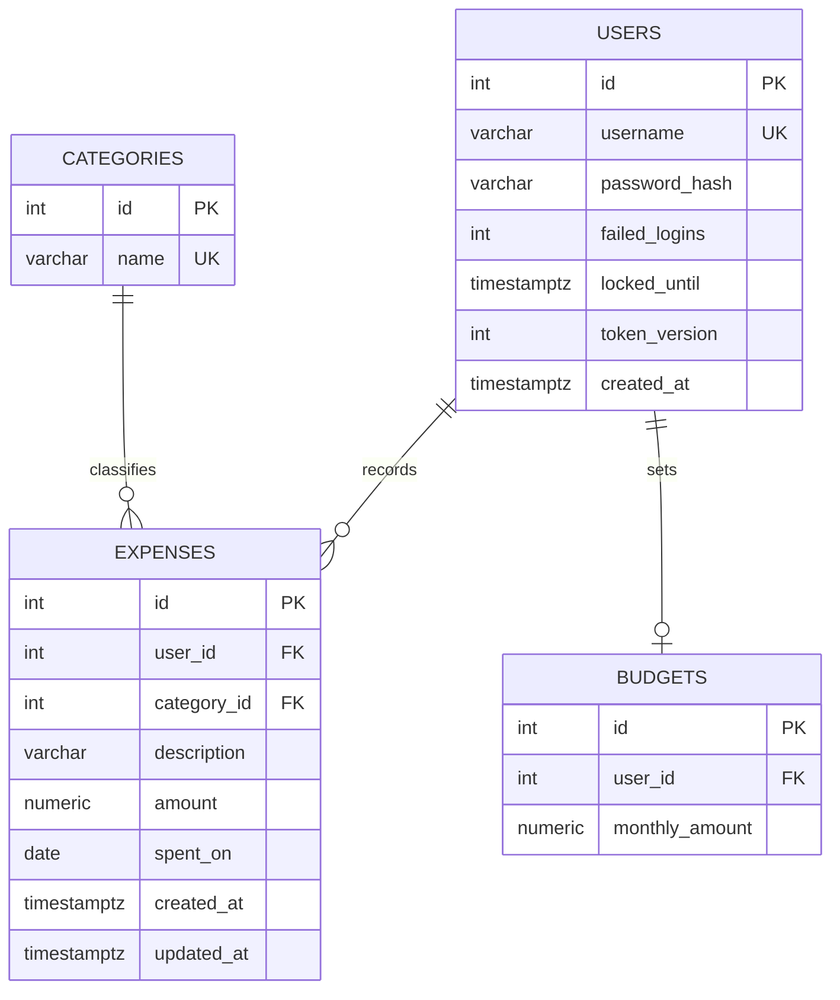
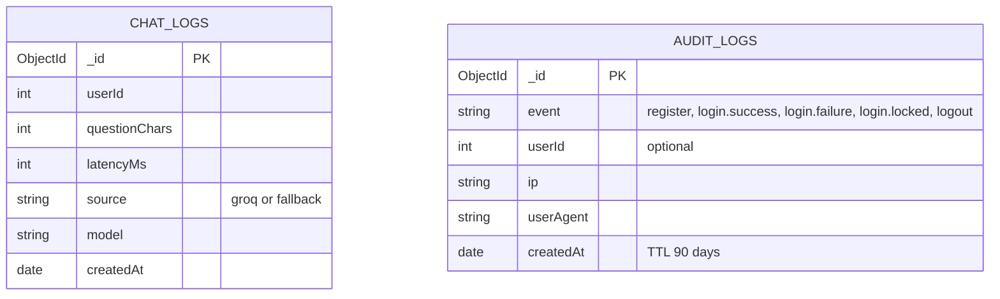

# ER diagram (draft, finalised in Phase 3)

## PostgreSQL (Supabase)

## MongoDB (Atlas): collections in database `finsight`

`userId` holds the Postgres `users.id` value. It is a reference only; MongoDB doesn't enforce foreign keys.

