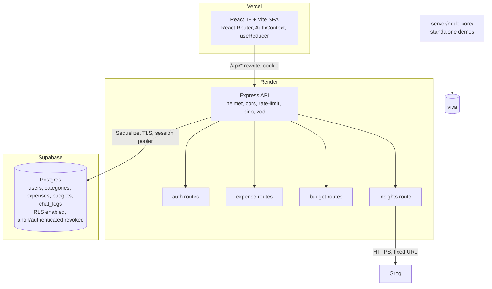

# Proposal

## 1. Problem

Students and young earners track spending loosely, if at all: a notes app, a bank SMS, a spreadsheet they abandon in week two. They don't know how much of the month's budget is left, which category is leaking money, or whether a purchase they're about to make fits. Existing apps (Walnut/axio, Money Manager, Splitwise) are either SMS-scraping and privacy-heavy, ad-supported, or built for splitting bills rather than personal budgeting.

## 2. Objectives

1. A private, account-based expense tracker: add, edit, delete, filter, paginate and export expenses.
2. A monthly budget with progress, category breakdown and an "afford this?" check.
3. A short AI tip based on the user's totals (not their raw data).
4. Built on exactly the syllabus stack (React + React Router, Node + Express, PostgreSQL + Sequelize, JWT + bcrypt, Vercel + Render), with every syllabus topic demonstrable in a viva.
5. Secure by design, mapped to the OWASP Top 10:2025.
6. Visually identical to FinSight.

## 3. Scope

**In scope:** register/login/logout, expense CRUD with categories and dates, server-side pagination and filtering, monthly budget, dashboard and analytics computed from real data, "Can I Afford This?", AI insights, CSV and XML export, Node core demos, tests, CI, deployment.

**Out of scope:** bank/SMS import, multi-currency, shared expenses, mobile app, email verification and password reset by email (no free mail provider is in the stack; noted as future scope), refresh-token rotation.

## 4. What we keep from FinSight

- **The UI:** `app/globals.css` verbatim with its class names; the sidebar (5 nav items, profile, logout), header (search + "Add expense"), cards, budget ring, category bars, recent rows, transaction table, analytics bento, donut, AI panel, Afford page, auth screen, and all copy.
- **The features:** auth, expenses, budget, analytics, AI insights, Can I Afford This?
- **The categories:** Food & Dining, Shopping, Transport, Entertainment, Bills, Health, Other. Currency ₹ with `en-IN` formatting.
- **Good ideas worth porting:** httpOnly cookie for the JWT (FinSight sets it in a Next.js route), user-scoped queries, `money()` and `groupExpenses()` helpers.

## 5. What we drop

| Item | Why |
|---|---|
| Next.js (`app/`, `layout.js`, API proxy routes) | Syllabus asks for React Router; Vite + a Vercel rewrite replaces the proxy |
| FastAPI, SQLAlchemy, SQLite, Pydantic | Replaced by Express, Sequelize, Postgres, zod |
| `app.py` (Streamlit), `test_stock.py`, `/stock/:symbol` (yfinance), Portfolio model and routes | Leftovers from the "Stockflow/stockbot" investment app, unrelated to expenses |
| `auth.py` | Dead code with a hard-coded `SECRET_KEY` |
| Plain-text legacy password login and duplicate-username handling in `/login` | Insecure migration path; fresh DB, unique usernames |
| Generic `/chat` with a "stock market analyst" prompt and `/history` | Replaced by a narrow `POST /api/insights` |
| "Stockflow"/"stockbot" names (page title, package name, cookie name, DB file) | Rebrand to the project name |

## 6. What FinSight fakes that we'll make real (look unchanged)

These render in FinSight but aren't wired to data. The new app keeps the same markup and makes them work:

- Pagination buttons (always page 1) → server-side pagination.
- Date button and the view toggles → a date-range filter (the toggles stay visual unless the team wants a card view).
- Header search box → debounced search over descriptions.
- Monthly Spending Trend bars (hard-coded heights, Jan to Jun) → last 6 months from data, via a month generator.
- Donut (hard-coded conic-gradient stops) → percentages from category totals.
- Budget ring (static borders) → reflects the percentage used.
- Totals are all-time in FinSight → scoped to the current month.

## 7. Target architecture

Data model: `User(id, username, password_hash, failed_logins, locked_until, token_version)`, `Category(id, name)`, `Expense(id, user_id, category_id, description, amount NUMERIC(12,2), spent_on DATE, created_at, updated_at)`, `Budget(id, user_id unique, monthly_amount)`, `ChatLog(id, user_id, prompt_chars, created_at)` (or in MongoDB, see Q3).

## 8. Risks

| Risk | Impact | Mitigation |
|---|---|---|
| Render free web services sleep after 15 min idle; first request takes ~30-60 s | Demo stalls; viva examiner sees a spinner | Open the app 2 minutes before the demo; client shows "Waking the server…" on slow `/api/me`; `/healthz` for a manual ping. Don't run a keep-alive cron (burns free hours, against the spirit of free tier). |
| Supabase free projects pause after 7 days without activity | DB unreachable on demo day | Weekly GitHub Actions job that runs one `SELECT 1` through the API's `/healthz?db=1`; check the dashboard the day before submission; keep `pg_dump` of seed data. |
| Groq free-tier rate limits (requests/min and tokens/day) and occasional outages | AI panel errors | Small model, capped prompt, per-user limit, 8 s timeout, friendly fallback text; the rest of the app doesn't depend on it. |
| Supabase direct connection is IPv6-only; Render has no outbound IPv6 | Connection fails on deploy | Use the Session pooler URI (IPv4) from day one, including locally. |
| Node.js 20 reached end-of-life on 2026-04-30 | No security patches; `npm audit` and Render may warn | Flagged as question 7; Node 22 LTS is a drop-in alternative. |
| Repo lives in OneDrive | Sync can lock `node_modules` or `.git` files and cause odd git errors | Pause OneDrive sync while working, or clone outside OneDrive. |
| Pixel-identical port of a 74-line minified `page.js` | Small visual drift | Playwright screenshots of both apps at the same viewport, per route, before merging Phase 6. |
| Group coordination | Merge conflicts, uneven contribution | Phases split by folder; PR rule; contribution table filled as PRs merge. |
